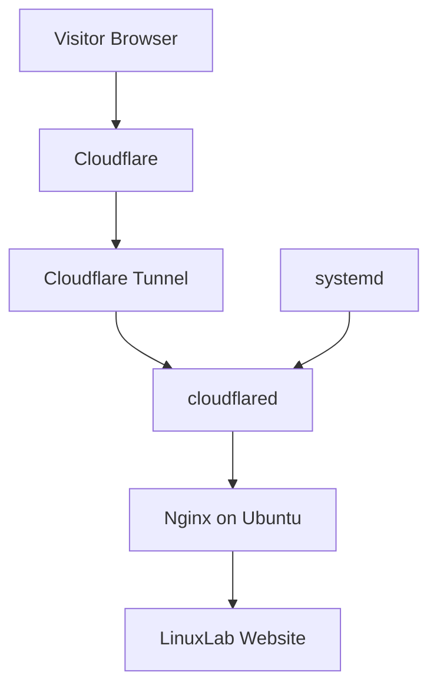
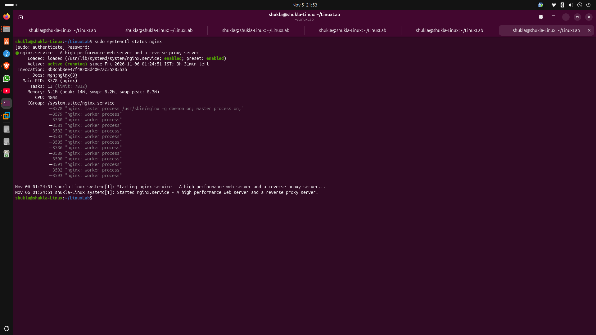
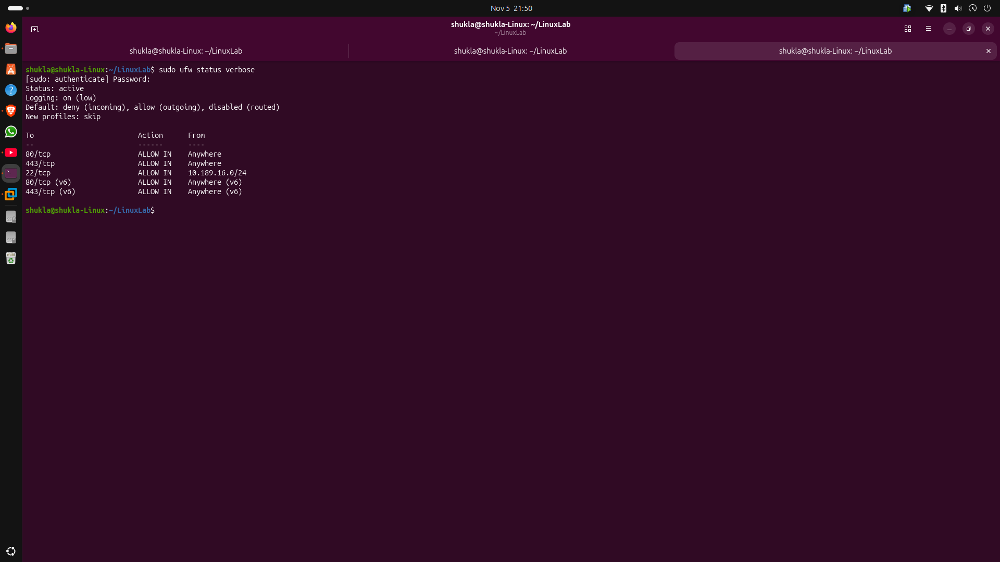
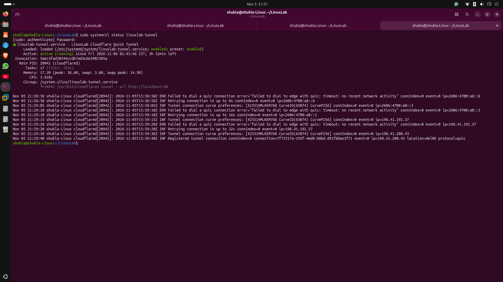
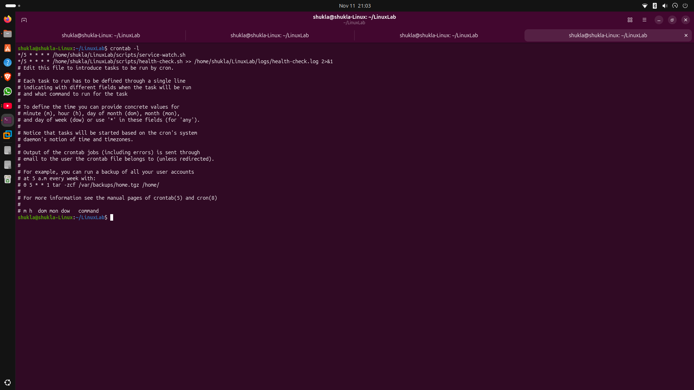

# 🚀 LinuxLab — Ubuntu Server Administration

A hands-on Linux system administration project built on a physical Ubuntu machine.

## 🌐 Overview

LinuxLab demonstrates how to configure and manage a self-hosted static website using Nginx on Ubuntu Linux and expose it externally through Cloudflare Tunnel.

## 🛠️ Technology Stack

| Technology | Purpose |
|---|---|
| Ubuntu Linux | Host operating system |
| Nginx | Web server |
| HTML | Website |
| Cloudflare Tunnel | External connectivity |
| systemd | Service management |
| UFW | Firewall |
| Git | Version control |

## ✨ Features

- Nginx web server configuration
- Static HTML website hosting
- Firewall management using UFW
- Cloudflare Quick Tunnel
- systemd service management
- Linux service monitoring and logs
- Troubleshooting documentation

## 🏗️ Architecture



## 📁 Project Structure

```text
LinuxLab/
├── docs/
│   ├── architecture.md
│   └── troubleshooting.md
├── nginx/
│   └── linuxlab.conf
├── systemd/
│   └── linuxlab-tunnel.service
├── screenshots/
├── index.html
├── .gitignore
└── README.md
```

## ⚙️ Installation and Testing

Update Ubuntu:

```bash
sudo apt update
```

Install Nginx:

```bash
sudo apt install nginx
```

Enable and start Nginx:

```bash
sudo systemctl enable --now nginx
```

Check configuration:

```bash
sudo nginx -t
```

Check service:

```bash
sudo systemctl status nginx
```

Test the local website:

```bash
curl -H "Host: linuxlab.local" http://127.0.0.1/
```

## ☁️ Cloudflare Tunnel

LinuxLab uses Cloudflare Quick Tunnel to make the local website accessible externally without router port forwarding.

Check the tunnel service:

```bash
sudo systemctl status linuxlab-tunnel
```

View tunnel logs:

```bash
sudo journalctl -u linuxlab-tunnel -n 50 --no-pager
```

**Note:** Quick Tunnel URLs are temporary and may change after a restart. This setup is intended for learning and experimentation, not production hosting.

## 🔍 Documentation

- [Architecture](docs/architecture.md)
- [Troubleshooting](docs/troubleshooting.md)

## 🔐 Security Notes

- Keep credentials, private keys and tokens out of Git.
- Never publish sensitive system logs or personal network details.
- Restrict SSH access to trusted networks.
- Understand that a public tunnel exposes the website to anyone with its URL.
- Review firewall rules before exposing services.


## 📸 Project Screenshots

### Website and Server

| LinuxLab Website | Nginx |
|---|---|
|  |  |

### Network and Connectivity

| Website Connectivity | Firewall |
|---|---|
|  |  |

### Cloudflare Tunnel

| Tunnel Configuration | Tunnel Logs |
|---|---|
|  |  |

### Monitoring and Automation

| Server Health | Cron Jobs |
|---|---|
|  |  |

### Service Monitoring Alerts


## 📊 Monitoring Features

- Bash-based CPU, RAM and disk monitoring.
- Nginx and Cloudflare Tunnel service checks.
- Service state-change detection and alert logging.
- Cron automation every five minutes.
- Health reports saved locally in the logs directory.


## 🎯 Future Improvements

- Configure a named Cloudflare Tunnel.
- Add HTTPS and a custom domain.
- Add monitoring and automated health checks.
- Improve website design.

## 👨‍💻 Author

**Sashwat Shukla**

Linux System Administration | Networking | Cloud Infrastructure Learning

